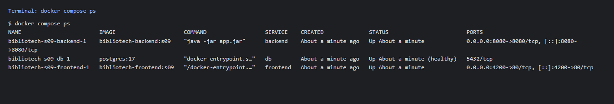
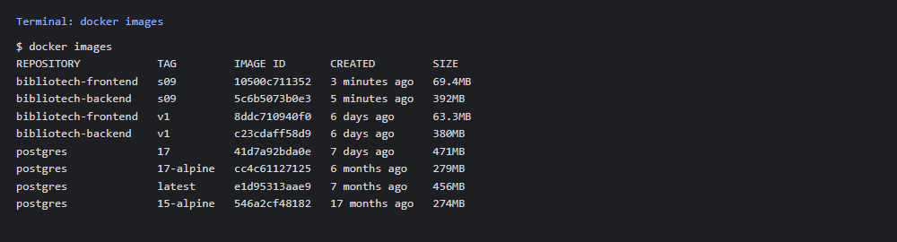
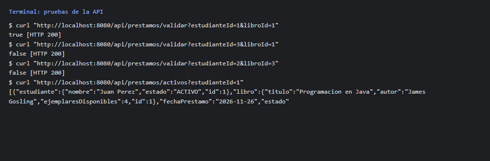
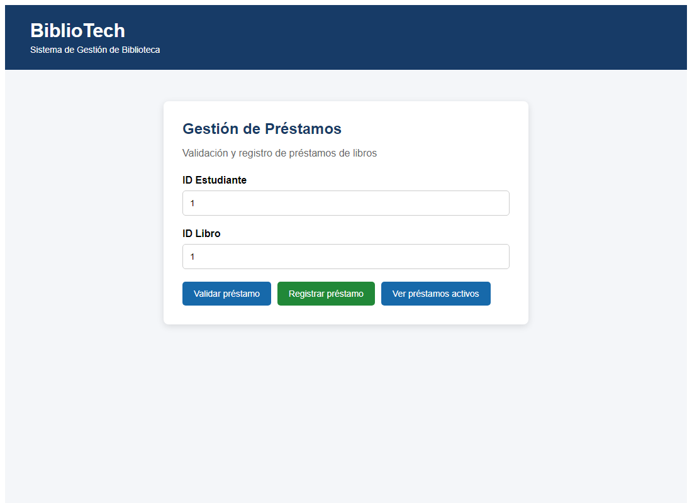

# DOCKER.md: despliegue local de BiblioTech con Docker

Documentación técnica del despliegue local de BiblioTech (Spring Boot + Angular + PostgreSQL) con contenedores.

Repositorio: <https://github.com/markmercado1/BiblioTech-Develop>

## 1. Requisitos previos

| Requisito | Versión usada | Para qué |
|---|---|---|
| Docker Desktop (Docker Engine y Docker Compose v2) | Engine 28.3 | Construir y ejecutar los contenedores |
| Puertos libres | 8080 y 4200 | API y sitio web |
| Archivo `.env` | ver sección 3 | Credenciales de la base de datos, fuera de Git |

No hace falta tener instalados Java, Maven ni Node.js: las imágenes los incluyen solo durante la compilación.

## 2. Estructura de contenedores

```
bibliotech/
├── backend/            Spring Boot 4, Java 21
│   ├── Dockerfile      multi-stage: eclipse-temurin:21-jdk (compila) -> eclipse-temurin:21-jre (ejecuta)
│   └── .dockerignore
├── frontend/           Angular 22
│   ├── Dockerfile      multi-stage: node:22-alpine (compila) -> nginx:alpine (sirve)
│   ├── nginx.conf      sirve Angular y reenvía /api/ al backend
│   └── .dockerignore
├── database/init.sql   esquema y datos iniciales de PostgreSQL
├── docker-compose.yml  orquesta los tres servicios
├── .env.example        plantilla de variables (el .env real no se sube a Git)
```

| Servicio | Imagen | Puerto | Función |
|---|---|---|---|
| `db` | `postgres:17` (versión fija) | 5432 solo dentro de la red de Compose | Base de datos, con volumen `postgres_data` y healthcheck |
| `backend` | construida desde `backend/Dockerfile` | 8080 | API REST de préstamos |
| `frontend` | construida desde `frontend/Dockerfile` | 4200 -> 80 | Interfaz Angular servida por Nginx |

Orden de arranque: `backend` espera a que `db` esté saludable (`depends_on` con `service_healthy`) y `frontend` espera al `backend`.

## 3. Configuración

Copiar la plantilla y poner una clave propia:

```powershell
Copy-Item .env.example .env
# editar .env y cambiar POSTGRES_PASSWORD
```

Contenido de `.env.example`:

```
POSTGRES_DB=bibliotech_db
POSTGRES_USER=postgres
POSTGRES_PASSWORD=cambiar_esta_clave
```

Opcionalmente se pueden definir `BACKEND_IMAGE` y `FRONTEND_IMAGE` para usar otras etiquetas de imagen (por defecto `bibliotech-backend:v1` y `bibliotech-frontend:v1`). `.env` está en `.gitignore`: las credenciales no se suben al repositorio.

Dentro de la red de Compose el backend se conecta a `jdbc:postgresql://db:5432/bibliotech_db`. Se usa el nombre del servicio `db` y no `localhost`, porque `localhost` dentro del contenedor del backend es el propio contenedor.

## 4. Comandos

### Construcción

```powershell
docker build -t bibliotech-backend:v1 ./backend
docker build -t bibliotech-frontend:v1 ./frontend
```

Construyen las dos imágenes. Cada Dockerfile es *multi-stage*: la primera etapa compila (Maven o Node) y la segunda solo contiene lo necesario para ejecutar, lo que reduce el tamaño de la imagen final.

### Ejecución

```powershell
docker compose up -d
```

Crea la red y el volumen, inicia la base de datos, luego el backend y luego el frontend, en segundo plano.

### Inspección

```powershell
docker compose ps                 # estado de los 3 servicios
docker compose logs -f backend    # registros del backend en vivo
docker images                     # imágenes disponibles
docker compose exec db psql -U postgres -d bibliotech_db -c "\dt"   # tablas de la base
```

Comprobación de la API:

```powershell
curl "http://localhost:8080/api/prestamos/validar?estudianteId=1&libroId=1"
curl "http://localhost:8080/api/prestamos/activos?estudianteId=1"
```

El sitio web está en <http://localhost:4200>.

### Detención

```powershell
docker compose down        # detiene y elimina contenedores y red; conserva los datos
docker compose down -v     # además borra el volumen: se pierden los datos de la base
```

## 5. Sistema funcionando

Los tres servicios activos (la base de datos aparece como `healthy`):



Imágenes construidas:



Respuestas de la API, incluida la nueva consulta de préstamos activos:



Frontend en el navegador:



## 6. Problemas encontrados y cómo se resolvieron

| Problema | Causa | Solución |
|---|---|---|
| El contenedor `db` se detenía al iniciar (`relation "estudiantes" does not exist`) | `database/init.sql` solo insertaba datos, pero en una base nueva las tablas aún no existen, porque las crea el backend después | Se agregaron las sentencias `CREATE TABLE IF NOT EXISTS` al inicio de `init.sql`, con el mismo esquema que las entidades JPA |
| Riesgo de borrar imágenes locales existentes al reconstruir | `docker-compose.yml` tenía fijas las etiquetas `:v1` | Se parametrizaron con `BACKEND_IMAGE` y `FRONTEND_IMAGE` (con valores por defecto) |
| `Connection refused` a la base desde el backend | Usar `localhost` en la URL de la base dentro del contenedor | La URL usa `db:5432` |
| `mvnw: bad interpreter` al construir en Windows | Saltos de línea CRLF en `mvnw` | El archivo del repositorio usa LF; si ocurre, convertirlo con `sed -i 's/\r$//' mvnw` en el Dockerfile |
| `port is already allocated` | Otro programa usa 8080 o 4200 | Cerrar el proceso o cambiar el puerto publicado en `docker-compose.yml` |
| Las credenciales no deben estar en el repositorio | Contraseña escrita en el compose | Variables `${POSTGRES_*}` leídas desde `.env`, que está en `.gitignore` |

## 7. Preguntas de metacognición

1. **¿Qué diferencia hay entre una imagen Docker y un contenedor?** La imagen es la plantilla inmutable con el sistema, las dependencias y la aplicación; el contenedor es una instancia en ejecución de esa imagen.
2. **¿Por qué usamos un Dockerfile multi-stage?** Para compilar con herramientas pesadas (JDK, Maven, Node) y copiar solo el resultado a una imagen final pequeña, más rápida y con menor superficie de ataque.
3. **¿Qué hace Docker Compose en BiblioTech?** Define y levanta los tres servicios juntos, con su red, su volumen, sus variables y el orden de arranque, con un solo comando.
4. **¿Por qué la URL de PostgreSQL usa `db` en lugar de `localhost`?** Porque cada contenedor tiene su propio `localhost`; en la red de Compose los servicios se encuentran por su nombre, y `db` es el nombre del servicio de la base.
5. **¿Qué diferencia hay entre lo que hace GitHub Actions y lo que hace Docker?** Docker empaqueta y ejecuta la aplicación en contenedores; GitHub Actions automatiza tareas (probar, construir, publicar) cada vez que cambia el código.
