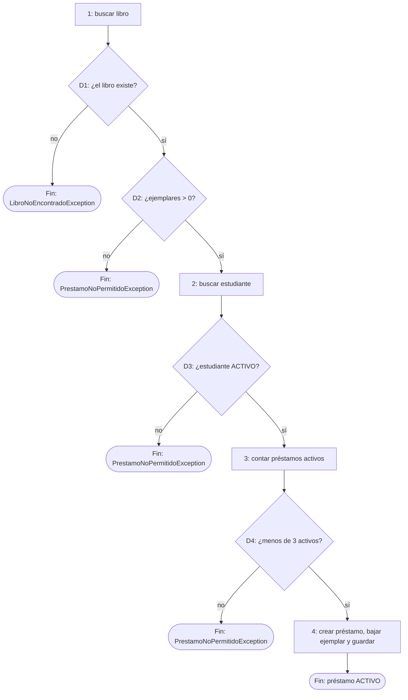
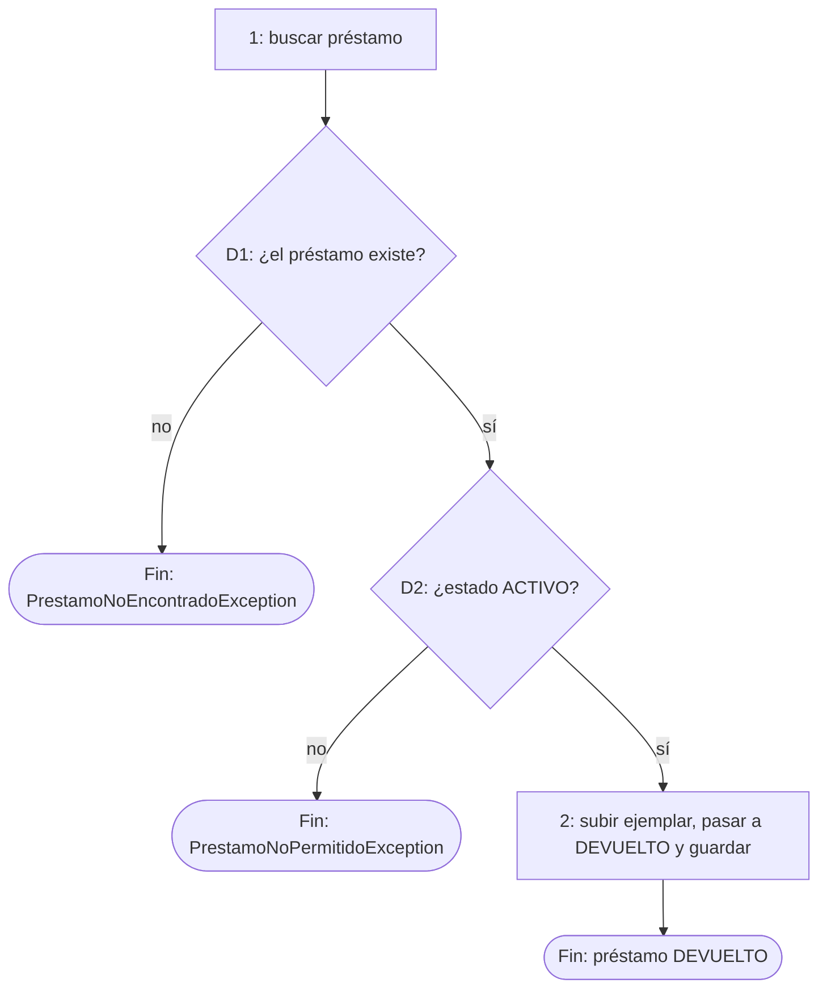

# Método del camino básico

Se aplica a los dos métodos de `PrestamoService` que concentran las decisiones de RN-03 y RN-04.
En cada grafo los nodos son bloques de código secuenciales y las aristas son el flujo de control.

## 1. `registrarPrestamo(estudianteId, libroId)` (RN-03)

### Código

```java
public Prestamo registrarPrestamo(Long estudianteId, Long libroId) {

    Optional<Libro> libroEncontrado = libroRepository.findById(libroId);
    if (libroEncontrado.isEmpty()) {                                        // D1
        throw new LibroNoEncontradoException();
    }
    Libro libro = libroEncontrado.get();

    if (libro.getEjemplaresDisponibles() <= 0) {                            // D2
        throw new PrestamoNoPermitidoException("El libro no tiene ejemplares disponibles");
    }

    Estudiante estudiante = estudianteRepository.findById(estudianteId)
            .orElseThrow(EstudianteNoEncontradoException::new);

    if (!Estudiante.ACTIVO.equalsIgnoreCase(estudiante.getEstado())) {      // D3
        throw new PrestamoNoPermitidoException("El estudiante no está activo");
    }

    long prestamosActivos = prestamoRepository
            .countByEstudianteIdAndEstado(estudianteId, ESTADO_ACTIVO);
    if (prestamosActivos >= MAXIMO_PRESTAMOS_ACTIVOS) {                     // D4
        throw new PrestamoNoPermitidoException("El estudiante alcanzó el máximo de 3 préstamos activos");
    }

    Prestamo prestamo = new Prestamo(estudiante, libro, LocalDate.now(), ESTADO_ACTIVO);
    libro.setEjemplaresDisponibles(libro.getEjemplaresDisponibles() - 1);
    libroRepository.save(libro);
    return prestamoRepository.save(prestamo);
}
```

### Grafo de flujo



### Complejidad ciclomática

- Nodos de decisión: 4 (D1, D2, D3, D4).
- V(G) = decisiones + 1 = 4 + 1 = **5**.
- Comprobación con aristas y nodos, uniendo todas las salidas en un solo nodo de fin: 12 aristas y 9 nodos (4 de decisión, 4 de proceso y 1 de fin). V(G) = A − N + 2 = 12 − 9 + 2 = **5**.

### Caminos independientes y casos de prueba

| Camino | Recorrido | Entrada | Resultado esperado | Prueba |
|---|---|---|---|---|
| 1 | D1 no | libro inexistente | `LibroNoEncontradoException` (404) | `CaminoBasicoRegistrarPrestamoTest.camino1_libroNoExiste` |
| 2 | D1 sí, D2 no | libro con 0 ejemplares | `PrestamoNoPermitidoException` (400) | `camino2_sinEjemplares` |
| 3 | D1 sí, D2 sí, D3 no | estudiante INACTIVO | `PrestamoNoPermitidoException` (400) | `camino3_estudianteInactivo` |
| 4 | D1 sí, D2 sí, D3 sí, D4 no | estudiante ACTIVO con 3 préstamos activos | `PrestamoNoPermitidoException` (400) | `camino4_maximoDePrestamos` |
| 5 | D1 sí, D2 sí, D3 sí, D4 sí | datos válidos | préstamo ACTIVO y un ejemplar menos | `camino5_prestamoExitoso` |

## 2. `devolverLibro(prestamoId)` (RN-04)

### Código

```java
public Prestamo devolverLibro(Long prestamoId) {

    Optional<Prestamo> prestamoEncontrado = prestamoRepository.findById(prestamoId);
    if (prestamoEncontrado.isEmpty()) {                                     // D1
        throw new PrestamoNoEncontradoException();
    }
    Prestamo prestamo = prestamoEncontrado.get();

    if (!ESTADO_ACTIVO.equals(prestamo.getEstado())) {                      // D2
        throw new PrestamoNoPermitidoException("El préstamo ya fue devuelto");
    }

    Libro libro = prestamo.getLibro();
    libro.setEjemplaresDisponibles(libro.getEjemplaresDisponibles() + 1);
    prestamo.setEstado(ESTADO_DEVUELTO);

    libroRepository.save(libro);
    return prestamoRepository.save(prestamo);
}
```

Las decisiones se identifican a partir de la regla RN-04: "el préstamo debe existir y estar ACTIVO".

### Grafo de flujo



### Complejidad ciclomática

- Nodos de decisión: 2 (D1, D2).
- V(G) = 2 + 1 = **3**.
- Comprobación con aristas y nodos, con un solo nodo de fin: 6 aristas y 5 nodos. V(G) = 6 − 5 + 2 = **3**.

### Caminos independientes y casos de prueba

| Camino | Recorrido | Entrada | Resultado esperado | Prueba |
|---|---|---|---|---|
| 1 | D1 no | préstamo inexistente | `PrestamoNoEncontradoException` (404) | `CaminoBasicoDevolverLibroTest.camino1_prestamoNoExiste` |
| 2 | D1 sí, D2 no | préstamo ya DEVUELTO | `PrestamoNoPermitidoException` (400) | `camino2_prestamoYaDevuelto` |
| 3 | D1 sí, D2 sí | préstamo ACTIVO | préstamo DEVUELTO y un ejemplar más | `camino3_devolucionExitosa` |
